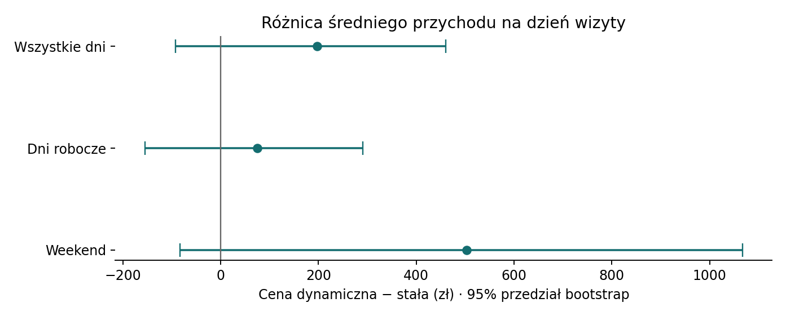

# Ceny dynamiczne biletów do aquaparku

Projekt portfolio pod stanowisko Junior Data Analyst w Droplabs. Dane są syntetyczne. Symulacja sprawdza, czy zmiana cen zwiększa średni dzienny przychód z biletów i jak wpływa na liczbę sprzedanych biletów.

| Strategia | Dni robocze | Weekend |
|---|---:|---:|
| Cena stała | 79 zł | 79 zł |
| Cena dynamiczna | 69 zł | 89 zł |

## Jak zaprojektowano eksperyment

224 dni wizyty podzielono na 16 dwutygodniowych bloków. W każdym bloku tworzymy pary tych samych dni tygodnia, np. dwóch poniedziałków. Losowo przydzielamy jednemu dniu z pary cenę stałą, a drugiemu dynamiczną. Wszystkie sesje dotyczące tej samej daty widzą tę samą cenę. Główna metryka to przychód z biletów na dzień wizyty. Liczba sprzedanych biletów to metryka dodatkowa.

Kod liczy różnicę wewnątrz każdej pary, a do oszacowania 95% przedziału bootstrap losuje całe bloki z powtórzeniami. Analiza dni roboczych i weekendów pokazuje, gdzie zmienia się wolumen.

## Wynik

| Metryka | Segment | Zmiana na dzień | 95% przedział bootstrap |
|---|---|---:|---:|
| Przychód | Wszystkie dni | +197 zł | od −92 do +460 zł |
| Bilety | Dni robocze | +15,12 | od +12,05 do +18,15 |
| Bilety | Weekend | −17,41 | od −24,22 do −10,72 |



W symulacji tańsze dni robocze mają większą sprzedaż, a droższe weekendy mniejszą. Przedział dla przychodu obejmuje zero, więc wynik nie wystarcza do podjęcia decyzji o wdrożeniu na podstawie przychodu. W prawdziwym teście sprawdziłbym także obłożenie, zwroty i to, czy cena skłania klientów do przenoszenia wizyty na inny dzień. Generator zakłada stały rozkład ruchu w obrębie typu dnia i z góry przyjętą reakcję popytu na cenę. Z tego powodu symulacja pokazuje sposób analizy, a jej liczby nie są prognozą dla prawdziwego aquaparku.

## Uruchomienie

```bash
python -m pip install -r requirements.txt
python analiza.py
```

Skrypt odtwarza dane, wyniki i wykres. W pliku `dane_syntetyczne.csv` jeden wiersz oznacza dzień wizyty. `sesje` to liczba sesji przypisanych do tej daty, `bilety` to liczba zakupów przy założeniu jednego biletu na sesję, a `przychod_pln` to liczba biletów pomnożona przez cenę. `wyniki.csv` zawiera średnie dla obu strategii, różnicę i przedziały dla wszystkich segmentów.
